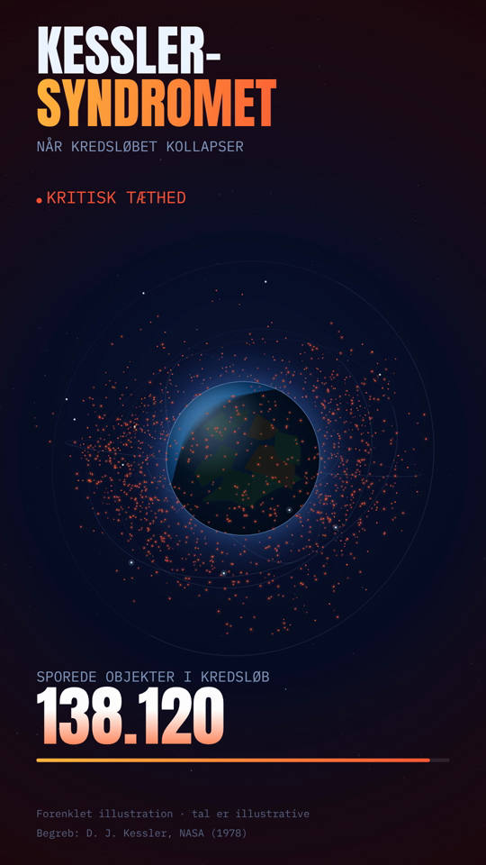

# Kessler-syndromet — animeret illustration (9:16, Instagram)

En selvstændig video-generator, der illustrerer **Kessler-syndromet**: Jorden i
centrum, satellitter i rene baner — og så en kollisions­kaskade, der fylder
kredsløbet med debris, indtil tætheden bliver kritisk.

Output: **1080×1920 (9:16), 30 fps, H.264 / yuv420p MP4** — klar til Instagram
Reels/Stories. Varighed ca. **26 sek** + et kort slut-hold.



## Kør den selv

Forudsætninger (én gang):

- [Node.js](https://nodejs.org) 18+
- `ffmpeg` på PATH — macOS: `brew install ffmpeg` · Windows: `winget install Gyan.FFmpeg` · Linux: `sudo apt install ffmpeg`

I denne mappe:

```bash
npm install
npx playwright install chromium
node make_video.js
```

Resultat: `kessler_syndrome.mp4` i mappen.

## Sådan er den bygget

- **`render.html`** — alt tegnes på ét `<canvas>`. Fuldt offline og selvstændig:
  skrifttyper (Anton + IBM Plex Mono) er indlejret som base64, ingen eksterne kald.
  - Jorden projiceres i 3D; satellitter og debris ligger på rigtige, hældede
    cirkel­baner (Kepler-agtig hastighed ∝ R⁻³ᐟ²) og bliver korrekt skjult bag
    kloden, når de passerer bagom.
  - Kaskaden er en deterministisk simulation: efter den første kollision stiger
    hver satellits sandsynlighed for at blive ramt med debris-tætheden i dens
    skal — det giver den eksponentielle "runaway", der er kernen i Kessler-syndromet.
- **`make_video.js`** — [Playwright](https://playwright.dev) (Chromium) tager et
  skærmbillede pr. frame, og `ffmpeg` encoder til MP4. Renderingen er deterministisk
  (fast seed), så den ser ens ud hver gang.
- **Én varigheds-knap:** `const DURATION` øverst i `render.html` (eksponeret som
  `window.__dur`). `make_video.js` læser den — længden står aldrig to steder.

### Juster

- **Længde:** ret `DURATION` i `render.html`.
- **Fart/kvalitet:** `FPS` og `CRF` øverst i `make_video.js`.
- **Hvor voldsom kaskaden er:** `K` (kollisions­konstant) og antal debris pr.
  kollision i `render.html`.

## GitHub Actions

Workflowet `.github/workflows/render-kessler.yml` (i repo-roden) kan køre
renderingen i skyen: **Actions → Render Kessler → Run workflow**. MP4'en lægges
op som artifact, og ved push af et tag (fx `v1.0`) vedhæftes den en Release.

## Noter om tallene

Videoen er en **forenklet illustration**. Tallet "sporede objekter i kredsløb"
er illustrativt og skal ikke læses som præcis statistik. Selve begrebet stammer
fra Donald J. Kessler (NASA), der beskrev scenariet i 1978.
