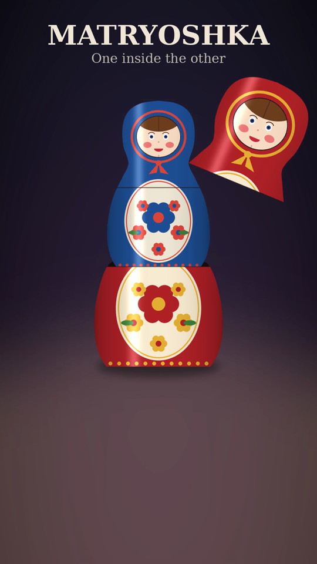

# Matryoshka — babusjka-dukker der åbner sig (9:16, Instagram)

En selvstændig video-generator: en babusjka-dukke åbner sig, den næste dukke
kommer op og lander ved siden af, og den ydre dukke stilles på en række —
indtil alle fem står fra største til mindste.

Output: **1080×1920 (9:16), 30 fps, H.264 / yuv420p MP4** — klar til Instagram
Reels/Stories. Varighed ca. **16,6 sek**. Al tekst på skærmen er på engelsk.



## Kør den selv

Forudsætninger (én gang):

- Python 3.9+ med `pip install pillow numpy`
- `ffmpeg` på PATH — macOS: `brew install ffmpeg` · Windows: `winget install Gyan.FFmpeg` · Linux: `sudo apt install ffmpeg`

I denne mappe:

```bash
python matryoshka.py preview    # et par stillbilleder i preview/ til hurtigt tjek
python matryoshka.py render     # hele videoen → matryoshka.mp4
```

Eller kør workflowet **Render Matryoshka** under Actions-fanen.

## Udskift dukkernes tegninger (textures)

Hver dukke males ud fra to billeder i `textures/`:

| Fil | Hvad | Størrelse |
|---|---|---|
| `dollN_face.png` | Ansigtet — beskæres automatisk ind i ansigtsovalen | gerne kvadratisk, ansigtet i midten |
| `dollN_body.png` | Hele dukkens forside (tørklæde, forklæde, mønster) | 620 × 1000 px |

`N` er 1–5, hvor 1 er den største. `textures/template.png` viser silhuetten,
ansigtsovalen og linjen, hvor dukken deler sig. Scriptet lægger selv
lak-glans, skygge og kant på, så egne tegninger får samme look.

`python matryoshka.py placeholders` genskaber pladsholder-billederne.

## Tekst og indstillinger

`config.json`: `title`, `subtitle`, `caption` (slutteksten), `labels`
(navneskilte under hver dukke i rækken), `num_dolls`, farver og `font`
(sti til en .ttf — ellers vælges en automatisk).

## Sådan er den bygget

- Alt tegnes med Pillow direkte i 1080×1920 og pipes som rå frames til `ffmpeg`
  (libx264, crf 18, +faststart) — ingen mellemliggende PNG-filer.
- Dukkens silhuet er en Catmull-Rom-kurve; hver dukke bygges som en øverste og
  en nederste halvdel, så toppen kan løftes og vippes af, mens den indre dukke
  stiger op bag den nederste halvdel.
- Tidslinjen ligger i `Scene.__init__` (`t_intro`, `t_open`, `t_last`, `t_outro`).
